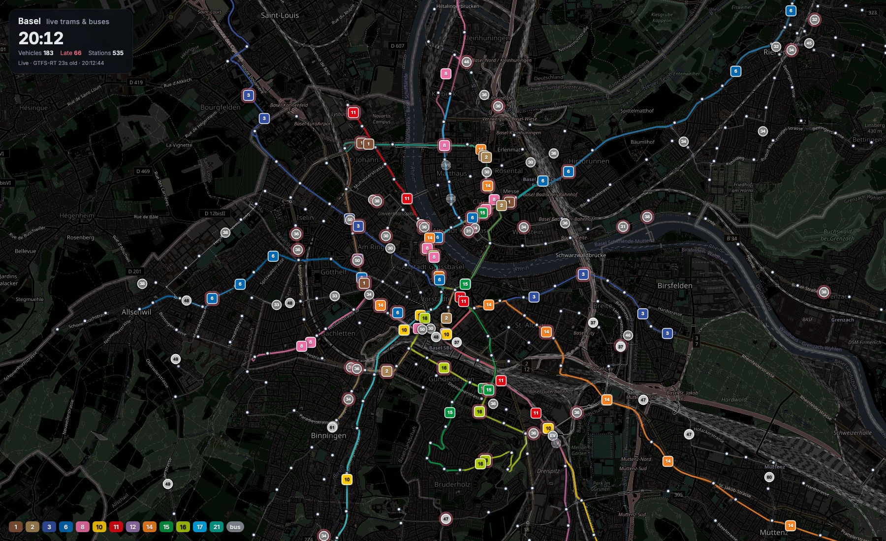

<h1 align="center">🚋 Basel Live</h1>

<p align="center">
  Every tram and bus in Basel, moving live on a map.<br>
  Real tracks, official line colours, real-life delays.
</p>

<p align="center">
  
</p>

<p align="center">
  <b>183 vehicles on a Monday evening · updated every 30 s · zero npm dependencies</b>
</p>

---

## What it does

- **Live positions** for all BVB and BLT trams and buses, interpolated along the real tracks between stops.
- **Official line colours** (tram 8 is pink, 11 is red, 10 is yellow…) straight from the OpenStreetMap route relations.
- **Real delays**: a tram running 3 minutes late is 3 minutes behind on the map. Late vehicles get a red glow, cancelled trips disappear.
- **Click any station** for its next 8 departures with live delays.
- **3D from zoom 16**: tilt with right-drag (or ctrl-drag) and every tram and bus becomes a 3D model in its operator's livery, articulated sections bending through the curves, with the line colour along its flank. Flexity, Combino, Tango, Tina and Citaro are modelled at their real lengths; which one runs a trip is a stable guess, since the feed doesn't say.
- **Aerial photos**: the *Aerial* button swaps the dark map for swisstopo's 10 cm SWISSIMAGE photos (Swiss side only). The dark map gets extruded 3D buildings instead.
- **Real light**: the 3D scene is lit by the sun's actual position over Basel; after dusk the street lights take over and the passenger compartments glow.
- **Screensaver mode**: the HUD fades out after 20 seconds without input, and after 45 seconds the camera starts a tour, gliding after one tram after another (*Tour* button to turn it off). The view is kept in the URL, so a link opens the same spot.

Switzerland publishes no vehicle GPS feed, so positions come from the national GTFS-RT *trip updates* (per-stop delays) applied to the timetable. In practice this is within a few dozen metres of the real vehicle.

## Setup (5 minutes)

You need **Python 3.9+** and a free **opentransportdata.swiss** token. Nothing else: MapLibre loads from a CDN, the server is Python standard library.

### 1. Clone

```bash
git clone https://github.com/dev-ale/basel-live.git && cd basel-live
```

### 2. Get a token

1. Register at <https://api-manager.opentransportdata.swiss/> (free).
2. Open the **GTFS-RT** product and click **Access with this plan**.
3. Copy the token into a `.env` file in the project folder:

```bash
echo "OTD_TOKEN=paste-your-token-here" > .env
```

### 3. Build the timetable subset

Downloads the Swiss GTFS zip (~290 MB) and filters it to BVB + BLT. Takes about a minute.

```bash
mkdir -p gtfs && curl -L -o gtfs/gtfs.zip 'https://data.opentransportdata.swiss/dataset/3d2c18f9-9ef1-463f-a249-5c67604efd74/resource/112426e8-d1d1-4244-92ff-a6a14329c256/download/gtfs_fp2026_20261010.zip' && python3 prepare_gtfs.py gtfs/gtfs.zip
```

> The timetable is republished twice a week at <https://data.opentransportdata.swiss/dataset/timetable-2026-gtfs2020>. If vehicles start showing as dashed "no live data", grab the newest zip and re-run this step.

### 4. Run

```bash
python3 server.py
```

Open <http://localhost:8765>. That's it.

<details>
<summary><b>No token? Run it without the server</b></summary>

```bash
python3 -m http.server 8765
```

The page then falls back to polling [transport.opendata.ch](https://transport.opendata.ch) stationboards for 24 hub stops. You get real delays but only the vehicles passing those hubs, roughly a third of the network.
</details>

## How it works

```
opentransportdata.swiss ──GTFS zip──▶ prepare_gtfs.py ──▶ gtfs/basel.json  (BVB+BLT timetable, 83 MB)
                        ──GTFS-RT ──▶ server.py  ──/vehicles.json──▶ app.js ──▶ MapLibre map
OpenStreetMap (Overpass) ──route relations──▶ build_routes.py ──▶ routes.json (tracks + colours)
transport.opendata.ch ◀──station click── app.js
```

| Piece | Role |
|---|---|
| `prepare_gtfs.py` | Streams the 4.5 GB Swiss GTFS out of the zip and keeps only BVB/BLT: 59 routes, ~188k trips/year, 1451 platforms. |
| `server.py` | Serves the page. Every 30 s it fetches the national GTFS-RT feed (one request, ~10k trips for all of Switzerland), keeps the Basel ones and merges the delays into today's schedule. Exposes `/vehicles.json` and `/stops.json`. |
| `app.js` | Polls `/vehicles.json` every 10 s and animates each vehicle between its last and next stop along the track. Each line's OSM ways form a graph; the vehicle follows the shortest path between the two stops (falling back to the whole tram or bus network for diversions). |
| `vehicles3d.js` | The 3D layer: a MapLibre custom layer drawn with three.js. Vehicle sections are built procedurally per type and drawn instanced, ~100 draw calls for the whole fleet. |
| `models/` | Optional real glTF models replacing the procedural ones; see [models/README.md](models/README.md). |
| `spike3d.html` | The Phase 0 test page: one tram at Barfüsserplatz with live scale, heading and float32-jitter checks. |
| `build_routes.py` | Turns an Overpass dump of route relations into `routes.json`. Already included for Basel; see below to refresh. |

## Refresh the track geometry

Only needed if OSM changes or you want another city. Uses the Swiss Overpass mirror, which is far less loaded than the main one.

```bash
curl -s 'https://overpass.osm.ch/api/interpreter' --data-urlencode 'data=[out:json][timeout:180];relation[route=tram](47.48,7.50,47.62,7.72);out geom;' -o osm_tram.json
```

```bash
curl -s 'https://overpass.osm.ch/api/interpreter' --data-urlencode 'data=[out:json][timeout:180];relation[route=bus][operator~"BVB|BLT"](47.50,7.53,47.61,7.67);out geom;' -o osm_bus.json
```

```bash
python3 build_routes.py osm_tram.json osm_bus.json > routes.json
```

## Another city?

The real-time feed covers all of Switzerland. Change `AGENCY_RE` in `prepare_gtfs.py`, fetch that city's OSM routes with a new bounding box, and adjust the hub list and initial view in `app.js`.

## Data sources & licences

- Timetable and real-time data: [opentransportdata.swiss](https://opentransportdata.swiss) (Open Data, free token required for GTFS-RT).
- Tracks, colours and basemap: © [OpenStreetMap](https://www.openstreetmap.org/copyright) contributors, ODbL; vector tiles by [OpenFreeMap](https://openfreemap.org).
- Aerial photos: © [swisstopo](https://www.swisstopo.admin.ch/) SWISSIMAGE, free geodata of the Swiss Confederation.
- Rendering: [MapLibre GL JS](https://maplibre.org) and [three.js](https://threejs.org), loaded from jsDelivr.
- Station departures: [transport.opendata.ch](https://transport.opendata.ch).
- Line colours are the official BVB/BLT colours as tagged in OSM; buses are grey as in OSM.

## Roadmap

This started as a POC for **Tram Chase**, a Scotland-Yard-style multiplayer game on the real network where delays in real life become delays in the game. The game layer (board, hop off, checkpoints) was prototyped and removed; it can sit on top of this data model.
